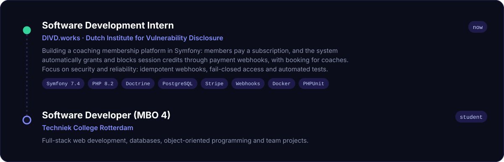
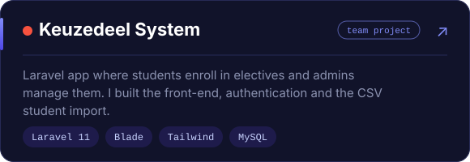
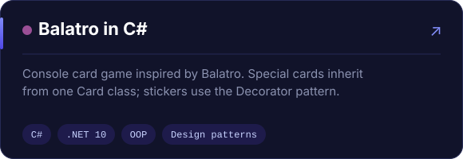
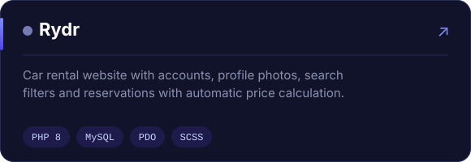
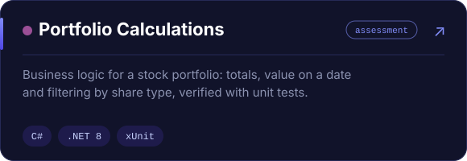
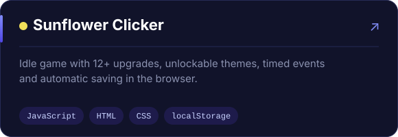
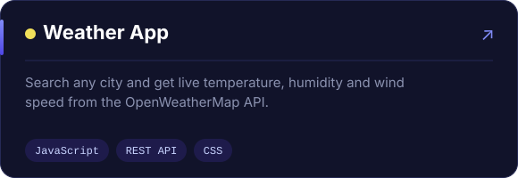

<p align="center">
  
</p>

<p align="center">
  <b>Software developer from Rotterdam</b>, currently doing my internship at <b>DIVD.works</b>.<br>
  I build PHP web applications with Symfony and Laravel, and I'm growing my skills in C#/.NET and secure software.
</p>

```php
class Marvellous extends Developer
{
    public string $role      = 'Software Developer';
    public string $currently = 'Intern @ DIVD.works';
    public string $studying  = 'Software Developer (MBO 4) @ Techniek College Rotterdam';
    public string $city      = 'Rotterdam, NL';
    public array  $stack     = ['PHP', 'Symfony', 'Laravel', 'PostgreSQL', 'C#'];
}
```

## Experience

<p align="center">
  
</p>

## Stack

<p align="center">
  
</p>

## Featured projects

<p align="center">
  <a href="https://github.com/Marvellous010/Laravel-periode-2-project"></a>
  <a href="https://github.com/Marvellous010/Balatro"></a>
  <a href="https://github.com/Marvellous010/Rydr-project"></a>
  <a href="https://github.com/Marvellous010/Stagairs-Opdracht"></a>
  <a href="https://github.com/Marvellous010/Project-1-cookie-clicker"></a>
  <a href="https://github.com/Marvellous010/Weather-app"></a>
</p>

<p align="center">
  
</p>
