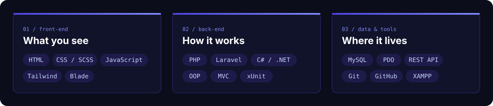

<p align="center">
  
</p>

Hi, I'm **Marvellous**. I'm a full-stack developer in training from Rotterdam, studying Software Development (MBO 4) at Techniek College Rotterdam. I like building the whole thing: database, back-end logic and the interface people click on.

```php
class Marvellous extends Developer
{
    public string $role     = 'Full-stack (PHP & Laravel)';
    public string $city     = 'Rotterdam';
    public string $learning = 'C# / .NET and unit testing';
    public string $lookingFor = 'Internship';
    public array  $stack    = ['PHP', 'Laravel', 'MySQL', 'JavaScript', 'C#'];
}
```

## Stack

<p align="center">
  
</p>

## Projects

```php
Project::latest()->get(['name', 'what', 'stack']);
```

| name | what | stack |
| --- | --- | --- |
| **[Keuzedeel System](https://github.com/Marvellous010/Laravel-periode-2-project)**<br><sub>team project</sub> | Web app where students sign up for electives and admins manage them. I built the front-end, login/registration and the CSV import that detects which electives a student already passed. | `Laravel 11` `Blade` `Tailwind` `MySQL` |
| **[Balatro in C#](https://github.com/Marvellous010/Balatro)** | Console card game inspired by Balatro. Special cards (Bonus, Glass, Wild, Steel) inherit from one `Card` class; stickers use the Decorator pattern. | `C#` `.NET 10` `OOP` |
| **[Rydr](https://github.com/Marvellous010/Rydr-project)** | Car rental website with accounts, profile photos, filters and reservations with automatic price calculation. | `PHP 8` `MySQL` `PDO` `SCSS` |
| **[Portfolio calculations](https://github.com/Marvellous010/Stagairs-Opdracht)**<br><sub>internship assignment</sub> | Business logic for a stock portfolio: totals, values on a date and filtering by share type, all checked with unit tests. | `C#` `.NET 8` `xUnit` |
| **[Sunflower Clicker](https://github.com/Marvellous010/Project-1-cookie-clicker)** | Idle game with 12+ upgrades, unlockable themes, timed events and auto-save. | `JavaScript` `localStorage` |
| **[Weather App](https://github.com/Marvellous010/Weather-app)** | Search any city and get live temperature, humidity and wind. | `JavaScript` `REST API` |

<sub>6 rows returned</sub>

## Contact

📍 Rotterdam, NL
